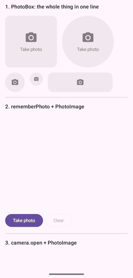

# FacilisCam

[](https://jitpack.io/#al3j4ndrolm/FacilisCam)
[](LICENSE)

**Android camera in one line.** No permission code, no CameraX setup, no manifest edits.

<p align="center">
  
</p>

```kotlin
camera.open { photo ->
    imageView.setImageURI(photo.uri)
}
```

Works from an Activity, Fragment, Compose or a ViewModel. No `Context`, no `init()`.

## Jetpack Compose

```kotlin
PhotoBox(Modifier.size(240.dp))
```

A complete photo field: tap it, take a photo, see it. Tap again to retake.

```kotlin
PhotoBox(Modifier.size(240.dp)) { photo -> upload(photo.uri) }   // get the photo
PhotoBox(Modifier.size(60.dp), shape = CircleShape)              // avatar picker
```

Want your own button? Use `rememberPhoto()`:

```kotlin
val photo = rememberPhoto()

Button(onClick = { photo.take() }) { Text("Take photo") }
PhotoImage(photo, Modifier.fillMaxWidth())
```

It survives rotation, even while the camera is open.

## Install

Add JitPack to `settings.gradle.kts`:

```kotlin
dependencyResolutionManagement {
    repositories {
        google()
        mavenCentral()
        maven("https://jitpack.io")
    }
}
```

Then add one dependency (min SDK 23):

```kotlin
// Compose apps: PhotoBox, PhotoImage, rememberPhoto, plus camera.open
implementation("com.github.al3j4ndrolm.FacilisCam:faciliscam-compose:1.1.1")

// Views apps: just camera.open
implementation("com.github.al3j4ndrolm.FacilisCam:faciliscam:1.1.1")
```

## Options

```kotlin
camera.open(
    lens = Lens.Front,          // Lens.Back (default) or Lens.Front
    saveTo = SaveTo.Gallery,    // SaveTo.Cache (default) or SaveTo.Gallery
    onCancel = { },             // user closed the camera
    onError = { e -> },         // no camera, capture failed
) { photo -> }
```

Prefer coroutines? `val photo = camera.capture() ?: return` (null if cancelled).

| `Photo` | |
|---|---|
| `photo.uri` | `content://` Uri for `setImageURI`, Coil, Glide or sharing |
| `photo.file` | The `File` (cache), or `null` when saved to the gallery |
| `photo.bitmap(maxSize)` | Decoded, upright, downscaled `Bitmap`. Call off the main thread |

`Photo` is `Parcelable`, so it works with `rememberSaveable` and `SavedStateHandle`.

## Included

- Permission request, with an **Open settings** button if the user blocks it
- Preview with tap-to-focus and pinch-to-zoom
- Flash and front/back switch, shown only when the device has them
- Photos saved upright; front-camera photos mirrored to match the preview

## Good to know

- If Android kills your process while the camera is open, the callback is lost with it.
- If your screen is recreated while the camera is open, keep the result in a `ViewModel` or `rememberSaveable`. `rememberPhoto()` and `PhotoBox` do this for you.

## Contributing

```bash
./gradlew :faciliscam:testDebugUnitTest :faciliscam-compose:assembleRelease :sample:assembleDebug
```

`faciliscam/` is the core library, `faciliscam-compose/` the Compose components, and `sample/` a demo app.

## License

[MIT](LICENSE)
